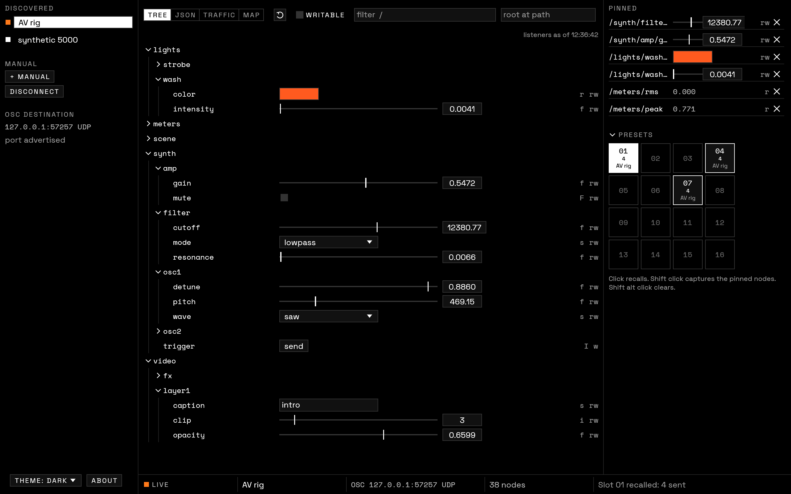
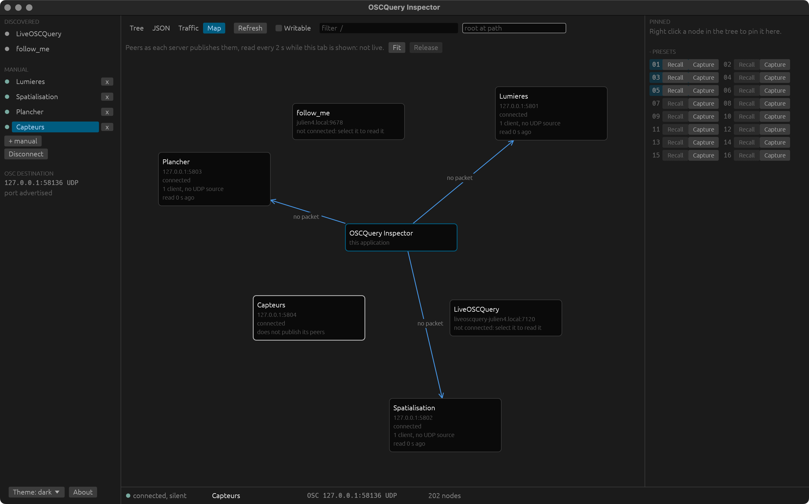
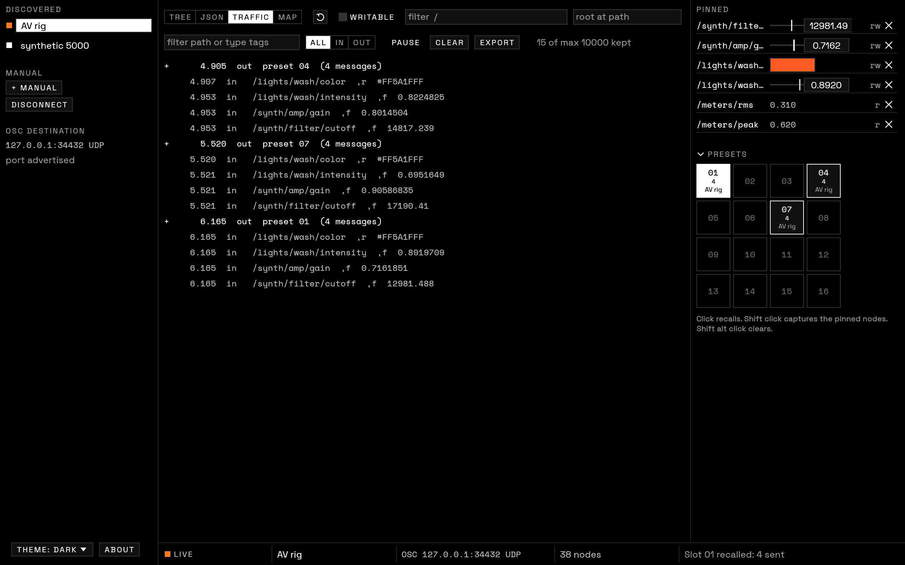
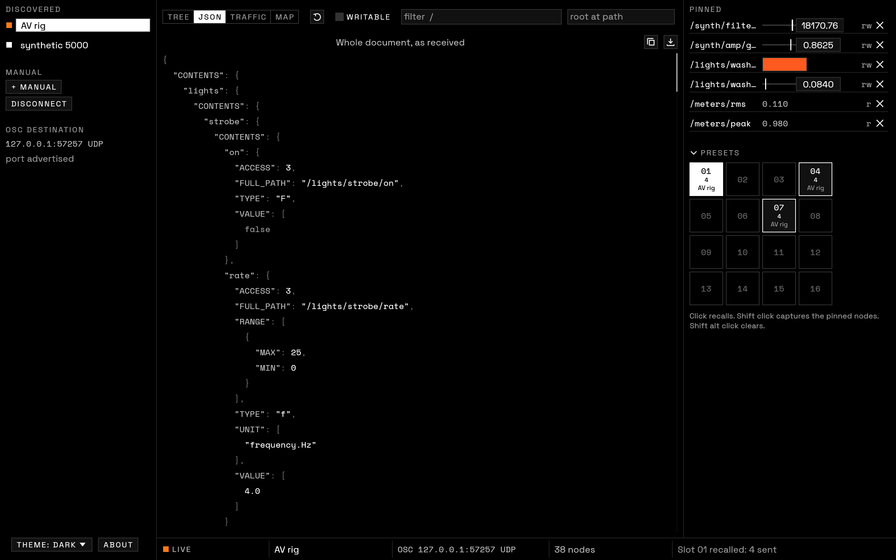
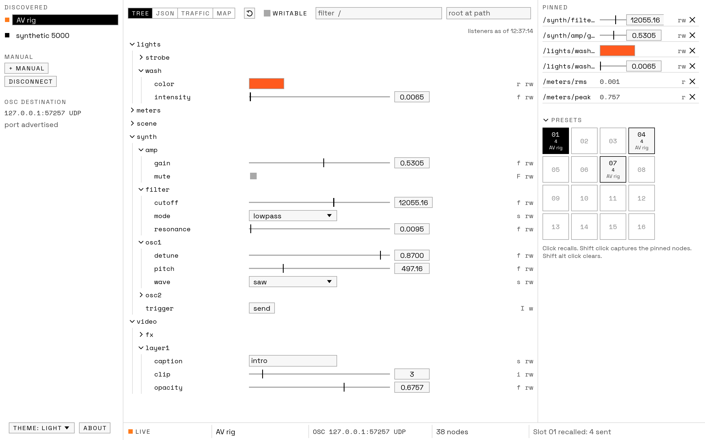

# OSCQuery Inspector

OSCQuery Inspector is a desktop application for macOS, Windows and Linux that connects to OSCQuery servers. OSCQuery is a protocol by which an application publishes its OSC address space, the list of everything it can be controlled with, as JSON over HTTP. OSCQuery Inspector finds those servers on the local network, shows their address space as a tree, shows each value and lets you change it, every change sent as an OSC message. It is meant for people who build or debug OSC setups: checking what a server really publishes, driving it by hand, and watching the messages that go out and come back.

**Download**: the [Releases page](https://github.com/gluon/oscq-inspector/releases), one file per system, free and unsigned; [how to open it the first time](docs/install.md). What changed between versions: [CHANGELOG.md](CHANGELOG.md).

<table>
  <tr>
    <td width="25%" valign="top"> <b>Map</b>: who is connected to whom, as each server publishes it, with the packets it counted.</td>
    <td width="25%" valign="top"> <b>Traffic</b>: three presets recalled, each a block out, and each value coming back over the WebSocket.</td>
    <td width="25%" valign="top"> <b>JSON</b>: the document as the server sent it, copied or saved in one click.</td>
    <td width="25%" valign="top"> <b>Light theme</b>, dark, or the system's.</td>
  </tr>
</table>

The window of 0.5.1. The map was taken against the PRISM demo device, found over Bonjour, and two synthetic servers entered by hand; the other images against a demo address space served by the synthetic server of this repository: [how they were taken](docs/images/readme/README.md).

## Features

- **Discovery**: servers advertised over Bonjour appear on their own; any other is added by hand with its `host:port`.
- **The address space as a tree**, fast with thousands of nodes, with a fuzzy filter and a prefix to root it anywhere.
- **Live values, and where they come from**: pushed by the server over its WebSocket or read on refresh; a value sent and not yet confirmed is marked as sent.
- **A widget fitting each type**: sliders, toggles, buttons, menus, text fields, colour pickers; the OSC goes to the port the server declares, coerced to the types it declares.
- **Pinned nodes**, per server, kept across restarts.
- **Presets**: sixteen slots with the gestures of Max's `preset` object, recalled on the same server or on another.
- **JSON and Traffic tabs**: each node's document as the server sent it, and every OSC message out and in, filtered and exported.
- **The map**: who is connected to whom, drawn from what each server publishes of its own connections, nothing guessed.

Each of them in detail, and the keyboard: [docs/manual.md](docs/manual.md).

## OSCQuery

OSCQuery Inspector implements the client side of the [OSCQuery Proposal](https://github.com/Vidvox/OSCQueryProposal) (Vidvox, third revision):

- the address space and its attributes over HTTP, `HOST_INFO` and its `EXTENSIONS`, the types and their ranges;
- discovery over Bonjour, `_oscjson._tcp`;
- values over the WebSocket: `LISTEN` and `IGNORE`, values received as binary OSC, the listens kept across reconnections;
- the structure notifications `PATH_CHANGED`, `PATH_ADDED`, `PATH_REMOVED` and `PATH_RENAMED`.

Each point is checked against the proposal's own sources, line by line, in [docs/protocol-notes.md](docs/protocol-notes.md), with what real servers do where they depart from it. Beyond the proposal, it reads the `PEERS` and `CLIENT_NAME` extension where a server declares it: that is what the map draws. Not implemented: OSC over TCP, and OSC sent over the WebSocket; OSC goes over UDP.

## Tested with

Vidvox OSCQuery Helper, Max 9, prism-oscquery and its demo device, and the synthetic server of this repository; macOS by hand, Linux and Windows in CI. What each server does and does not do: [docs/compatibility.md](docs/compatibility.md).

## Documentation

- [docs/install.md](docs/install.md): download and first launch on macOS, Windows and Linux.
- [docs/manual.md](docs/manual.md): the manual, everything the window does.
- [docs/compatibility.md](docs/compatibility.md): the servers and the systems it was tested with.
- [CHANGELOG.md](CHANGELOG.md): what changed in every published version.
- [DEVELOPMENT.md](DEVELOPMENT.md): building from source, the workspace and its tools, the performance budgets, the release, the status and the backlog, and the project's working files, left visible so that the reasoning behind the code can be read.
- [CONTRIBUTING.md](CONTRIBUTING.md): how reports and pull requests are handled.

## Status

Latest version: **0.5.1**, 2026-11-21. Formerly void-oscq, published under that name up to 0.2.3. The status of every version and the backlog are in [DEVELOPMENT.md](DEVELOPMENT.md#status-and-backlog).

## License

Copyright (C) 2026 Julien Bayle, Structure Void. OSCQuery Inspector is free software under the GNU General Public License, version 3 or any later version ([LICENSE](LICENSE)), with an additional permission for the fonts compiled into the application ([LICENSE-EXCEPTION](LICENSE-EXCEPTION)). The fonts keep their own licenses, in [licenses/fonts](licenses/fonts).
